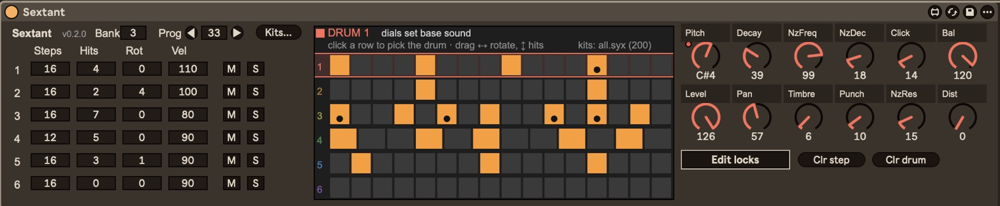
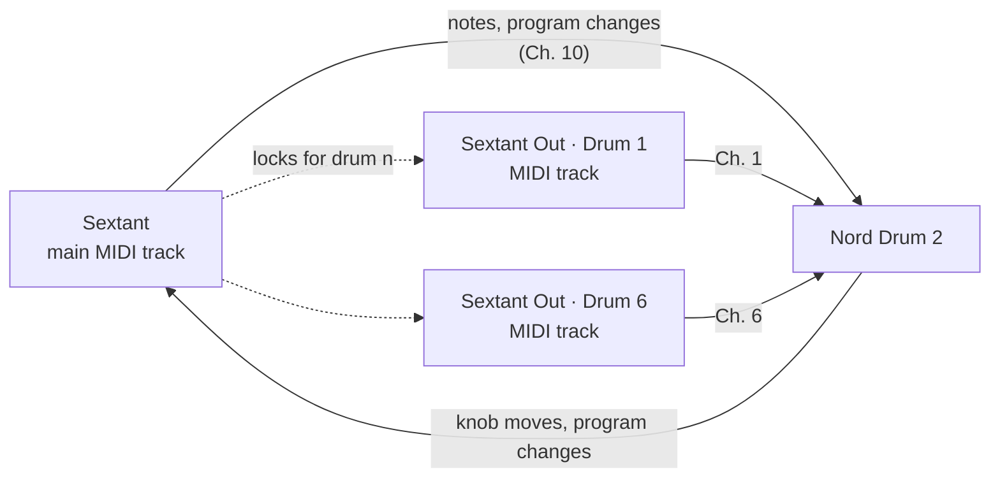

# Sextant — Euclidean sequencer for Nord Drum 2

A Max for Live device that sequences the six channels of a **Nord Drum 2** with Euclidean rhythms and
Elektron-style **per-step parameter locks**, while keeping the Nord's own program as the base sound.



## Features

- **Six Euclidean voices**, one per Nord Drum 2 channel: steps (1–64), hits, rotation and velocity. Each drum loops on
  its own length, so polymeters come for free. Synced to Live's transport in 16th notes.
- **Step grid**: drag a row left/right to rotate it, up/down to add or remove hits.
- **Parameter locks on 12 knobs per drum.** Each knob's menu picks any of the Nord's 32 sound parameters, or note
  **Velocity**, and every drum can have its own knob layout.
- **The kit stays the base sound.** Load a SysEx dump of your Nord programs and Sextant knows every value of every
  program: locked steps return to the program's sound, and **Clr drum** restores it.
- **Program control**: Bank/Prog display and ◀ ▶ that switch the Nord, and follow program changes made on the Nord.
- **Mute / Solo** per drum, the Live way.
- Plays nicely with **automation**: knobs automate the base sound; only a hand on a knob writes a lock.

## Requirements

- Ableton Live 12 Suite, or Live 12 Standard with Max for Live, with Max 9 (bundled with recent Live 12 releases).
  Developed and tested on Live 12.4.
- Nord Drum 2 with OS 3.0x, connected both ways (MIDI In **and** Out) to your computer's MIDI interface.
- Optional, for kit values: [SysEx Librarian](https://www.snoize.com/sysexlibrarian/) (macOS) or any app that can
  record a SysEx dump to a `.syx` file.

## Setup

### 1. Install the devices

Download `Sextant-x.y.z.zip` from [Releases](../../releases) and put `Sextant.amxd` and `Sextant Out.amxd` in your
User Library, e.g. `Presets/MIDI Effects/Max MIDI Effect/Sextant/`.

### 2. Nord Drum 2 settings

Hold **Shift** and press **MIDI** repeatedly to step through the MIDI settings; turn the dial to change one.

| Setting | Value | Why |
|---|---|---|
| `L.` global channel | `L.10` (factory) | Sextant plays notes on channel 10 |
| `Ch.` per-drum channels | `Ch.1` … `Ch.6`, one per drum | each drum's locks go to its own channel |
| `n.` notes | factory: 60, 62, 64, 65, 67, 69 | the notes Sextant plays |
| `PC.` program change | `PC.Sr` | Sextant switches and follows programs |
| `CC.` control change | `CC.Sr` | locks out, knob moves in |

### 3. Live's MIDI settings

In *Settings → Link, Tempo & MIDI*, for the port the Nord is connected to:

- **Output**: Track on.
- **Input**: Track **and Remote** on. With Track only, Live doesn't pass the Nord's program changes to the device.

### 4. Tracks

Live rewrites every MIDI message that leaves a track to that track's output channel, so one track can't talk to the
Nord's seven channels. Sextant therefore uses one main track and six small helper tracks:



1. **Main track**: a MIDI track with **Sextant**. MIDI To: the Nord's port, **Ch. 10**. MIDI From: the Nord's
   port, all channels, Monitor **In**.
2. **Six Out tracks**: six MIDI tracks, each with **Sextant Out**. Set its *Drum* box to 1…6, MIDI To: the Nord's
   port, the **same channel** (Ch. 1…6). MIDI From: No Input.
3. Optional: select the six Out tracks and press ⌘G to group and fold them.

**Shortcut for step 2:** [`templates/Sextant Out tracks.als`](templates) holds the grouped six Out tracks, already set
to Drum 1–6 and Ch. 1–6. Drag it from Live's browser into your Set, then set each track's MIDI To port to your Nord
(the port in the file is a placeholder); check the channel is still 1–6 afterwards. Once everything's set up,
save it as your own template.

### 5. Load your kits (recommended)

1. In SysEx Librarian choose the Nord's port as the source and start recording.
2. On the Nord: **Shift + MIDI** until the display shows `ALL`, then press **Program**. Save the recording, e.g.
   `nord-all.syx`.
3. In Sextant click **Kits…** and choose the file. The grid header shows `kits: nord-all.syx (N)`.

From then on, every program change sets each drum's base sound to that program's stored values. If you store new
edits on the Nord, record and load a fresh dump.

## Using it

- **Pattern table** (left): Steps, Hits, Rot(ation), Vel(ocity), **M**ute and **S**olo per drum.
- **Grid**: orange = hits, white = playhead. Click a row to select the drum whose knobs are shown; drag ↔ to rotate,
  ↕ to change hits. The header shows the selected drum, last incoming MIDI and the loaded kits file.
- **Knobs** (right): 12 per drum, colour-coded to the selected drum. The menu above each knob chooses its
  parameter (each drum keeps its own layout).
  - **Edit locks off**: knobs set the drum's base sound and send it right away.
  - **Edit locks on**: click a hit, then turn knobs to lock values on that step (blue dot). Click the step again to
    deselect. **Clr step**, shift-click, or **Clr drum** remove locks; Clr drum also restores the program's sound.
- **Hollow dot / red header line**: a locked parameter has no base value to return to (no kits loaded and never
  touched). Nudge that knob on the Nord once, or load your kits.
- **Melodies**: lock **Pitch** per step. The Pitch knob shows note names (Live's convention, 60 = C3; the Nord's
  A440 is A3), and unlocked hits return to the kit's tuning.
- **Bank / Prog**: type, drag or use ◀ ▶ (rolls over between banks).

### Automation

The automation chooser lists `1 Steps` … `6 Solo` and `Knob 1–12`. Knob automation changes the **selected drum's**
base sound; it never writes locks, and Sextant won't move a knob that automation is driving.

## Known limitations

- **Level and Pan can't be locked.** The Nord glides these two instead of jumping, so per-step changes land on the
  wrong hit. Use **Velocity** locks for accents. Both still work as base sound and automation.
- **Bank changes on the Nord's panel aren't seen** (the Nord sends no bank number). Set Sextant's Bank to match once.
- Knob automation follows the selected drum rather than a fixed one.
- Max for Live JavaScript runs at a lower priority than Live's audio, so under heavy CPU load timing can wobble
  slightly more than with plain MIDI clips.
- Not tested with the Nord Drum 3P, which has a similar MIDI implementation.

## How the Nord's SysEx was decoded

Clavia doesn't document the Nord Drum 2 program format. It was worked out from real dumps, single-parameter edits and
a probe that sets all 32 parameters to known values (`tools/sysex/`), and checked against 200 programs. See
[docs/nord_drum2_sysex_format.md](docs/nord_drum2_sysex_format.md).

## Building from source

The devices are generated: the logic is plain JavaScript in `code/`, and Python scripts in `tools/` write the Max
patches and `.amxd` files, embedding the JavaScript.

```sh
npm test                 # engine tests (Node 18+)
npm run build            # writes devices/Sextant.amxd and devices/Sextant Out.amxd (Python 3)
python3 tools/build.py --install "~/Music/Ableton/User Library"
npm run package          # tests + build + dist/Sextant-<version>.zip
```

See [CONTRIBUTING.md](CONTRIBUTING.md) for the layout and release steps.

## Licence and trademarks

[MIT](LICENSE). Nord and Nord Drum are trademarks of Clavia DMI AB; Ableton, Live and Max for Live are trademarks of
Ableton AG; Max is a trademark of Cycling '74. Sextant is an independent project, not affiliated with or endorsed by
any of them.
